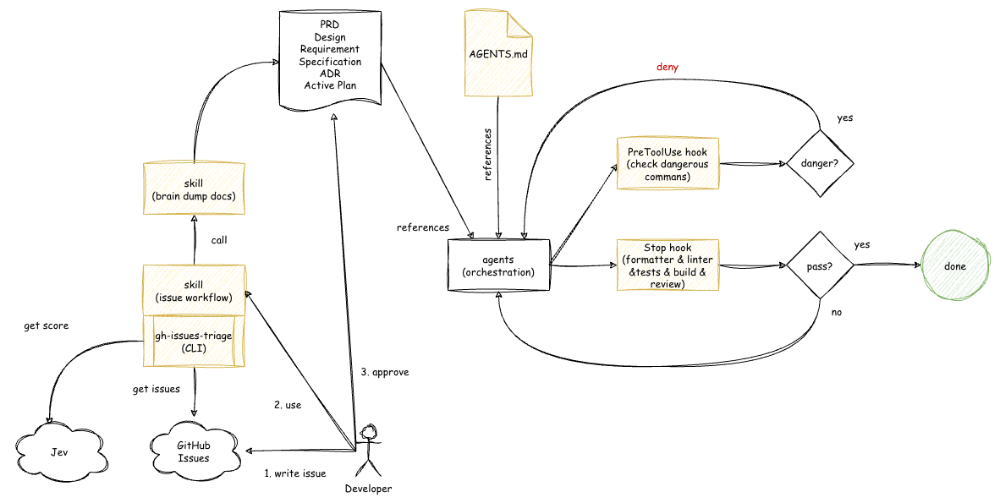

# AGENTS.md

生成 AI 技術 (以下 AI) の性能が驚くような速度で進歩している状況でも、「何を解決するのか」「誰に届けるのか」「開発者に依存しない開発速度」など原始的かつ根本的なエンジニアの本質は何も変わってないと思います。昔のエンジニアは課題・問題を解決するための一つの手段としてプログラムを書いてたわけですが、あくまでも手段の一つなだけでプログラムを書くこと自体が仕事というわけではないと個人的には考えています。それゆえ AI で開発する時代だからこそ以下が必要であると考えます。

- ドキュメントの管理・運用
- ソースコードの品質 (可読性や保守性)

解決するために、何を作ろうとしてるのか、何をしたいのかなどを人間が理解するためにドキュメントは必要ですし、コンテキストとして AI にも必要です。可読性・保守性のあるコードも AI が勘違いしないためには必要です。

本プロジェクトは、各プロジェクトに依存しない汎用的なルールとドキュメントを管理・運用するスキルとコードが一定の品質になるようなハーネスで構成されています。アーキテクチャは下記のとおりです。



## ルール・スキル・ハーネス

### グローバル AGENTS.md

`global-agents.md` はコードの書き方やエージェントの挙動について定義したファイルです。

```shell
ln -s /path/to/global-agents.md ~/.codex/AGENTS.md
```

### issue-workflow スキル

このスキルは [GH Issues Triage](https://github.com/tkumata/gh-issues-triage) が必要です。

GitHub Issues を Jev でトリアージして、その中から重要な一つを抽出し、`brain-dump-docs` スキルに渡してドキュメントを作成します。

このスキルを利用することで、アイデア・課題・brain dump を GitHub Issues に集約することができます。チームで開発している中で「xxx について、どこ見ればいいの？」ということが減ります。しかも GitHub Issues が増えてもトリアージツールが必要な issue だけ抜き出してくれるので問題ないと思います。

### brain-dump-docs スキル

ユーザの曖昧なアイデアや brain dump を基に具体的な仕様などの開発に必要なドキュメント群 (PRD、要件定義書、設計書、仕様書、ADR、Active Plan) を作成します。

Active Plan は、エージェントに働かせるセッションに対して一つのファイルになります。この中に Task を割り振っており、なんらかの原因でエージェントが止まっても途中から作業を再開できます。また、品源に作業を引き継ぐ場合にも利用できます。

### ハーネス

sudo や破壊的な git や rm など危険な CLI コマンドを、PreToolUse hook でエージェントが動く前に検知して止めるためのハーネスです。

フォーマッタ、リンタ、テスト、ビルド、レビューを Stop hook で引っ掛けて完了するまでループします。ESP-IDF / Pico SDK や Rust に対応しています。

Rust に関してはリンタが優秀なので、このハーネスを使うとビルド時の Warning すら一才出ないビルド可能なコードを生成します。

#### Pico-SDK の場合

`.h`, `.c`, `.cpp`, `.hpp`, `.cmake` などソースコードファイルの fingerprint を見て、違いがあればフォーマットチェックとビルドを行い、結果をエージェントに返します。これにより、多純な質問などではハーネスが発火せずソースコードなどを編集した時だけハーネスが発火します。

#### ESP-IDF の場合

外部ツール (clang-formatter, cppcheck, clang-tidy など) で Format, Lint チェックすると誤検知が多い (ESP-IDF が想定している記述と違うっぽい) ので `idf.py` を経由してチェックするために `idf.py build` と `idf.py size` を実施するようにしました。

C/C++、assembly、ESP-IDF のビルド設定、component manifest、partition table、ハーネス設定に変更がある場合だけ、`Stop hook` は build と size を順番に実行します。両方の成功後、現在の未コミット変更を正しさ、回帰、セキュリティ、テスト、ドキュメント整合性の観点でコードレビューするよう自然言語で指示します。質問や Markdown のみの変更、および同一の検証済み差分では何も出力しません。レビューで関連ファイルを変更した場合は、次の `Stop hook` で build から再検証します。

なお、`idf.py clang-format` は開発中のため除外しました。

#### Rust の場合

パニックになる可能性のあるコードをエラー扱いするように Linter を設定しました。

Rust 関連ファイルに変更がある場合、`Stop hook` は fingerprint の変化に応じて `make check` と `make build` を実行します。検証成功後は、現在の未コミット変更を正しさ、回帰、セキュリティ、テスト、ドキュメント整合性の観点でコードレビューするよう自然言語でエージェントへ指示します。

レビューで Rust 関連ファイルを変更した場合は、次の `Stop hook` で検証をやり直します。

## コンポーネント

[GH Issues Triage](https://github.com/tkumata/gh-issues-triage): GitHub Issues をトリアージするツールです。ローカル PC で TUI として実行できますし、スキルから呼び出しても CLI としても利用できます。†1

## 補足

†1: macOS の場合 Keychain.app の認証が必要です。認証ダイアログが毎回出現します。

## 募集

当初プロジェクト名を AGENTS.md としてルールの記述だけしていたのですが、スキルやハーネスなども追加することになりプロジェクト名と機能が乖離してきたので新しいプロジェクト名にしたいと考えています。
